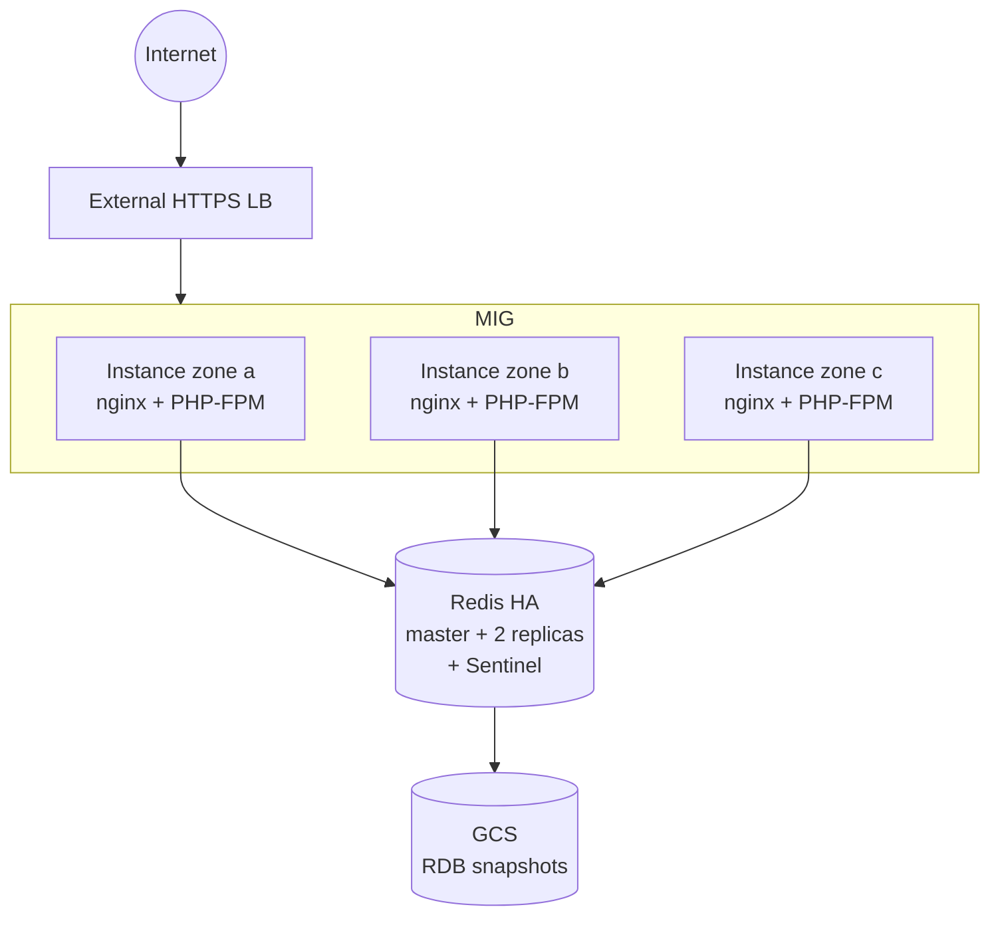

# HA Proposal

## Context

The current deployment runs everything on a single VM: nginx, PHP-FPM, Redis,
and the application code. It works, but it cannot survive a failure. If the
VM goes down, the service and its state go with it.

This document describes the target architecture and the migration path to a
production-grade, highly available platform on GCP.

## 1. High Availability & Horizontal Scaling

**Decision**

- Regional MIG across three zones, using a Packer image.
- External HTTPS Load Balancer in front. The health check hits `GET /` and
  expects HTTP 200 with the Guestbook page.
- nginx and PHP-FPM run together on each instance, so they scale together.
- Autoscaling on CPU.

**Alternatives considered**

- **Hot standby.** Two static VMs in separate zones, one active and one
  passive, behind a load balancer. Provides failover, but no autoscaling,
  no self-healing, and no built-in rolling update. Replacing a failed
  instance or deploying a new image is a manual task.
- **Nomad Autoscaler.** Scales the MIG from outside, using Nomad's view of
  the load instead of GCP metrics. A good fit for larger workloads that
  already run Nomad. Overkill for a single counter.
- **Self-hosted load balancer** (HAProxy, Envoy). Removes the only managed
  component, but adds a service to run and patch. Not justified: the load
  balancer holds no data.

**Why this decision**

A Regional MIG is the smallest change that removes the single point of
failure. It reuses the same instance design, keeps nginx and PHP-FPM together,
and adds no new services. Packer images make instances immutable, so scaling
and replacement are predictable. The load balancer becomes the only public
entry point, so clients are no longer tied to specific instances.

## 2. Resilient Data Layer

**Decision**

- Self-managed Redis HA: one master, two replicas, one per zone.
- Sentinel runs on each node for automatic failover. Clients ask it which
  node is the master.
- AOF persistence on every node, synced every second.
- RDB snapshots go to a GCS bucket every hour, with 7-day retention.
- Private IPs only. No public endpoint.

**Alternatives considered**

- **Memorystore for Redis.** Managed HA out of the box. Rejected: not used
  in this environment.
- **Redis Cluster.** Splits data across multiple nodes and scales writes.
  Our workload is a single counter, small enough for one node. Cluster mode
  is overkill here.

**Why this decision**

Sentinel is the standard for Redis HA. Three nodes survive the loss of one
node or one zone. Failover is automatic, and clients find the new master
through Sentinel. AOF everysec limits data loss to one second. Periodic RDB
snapshots give a backup that does not depend on replaying the AOF.

## 3. State & Session Management

**Decision**

- PHP sessions move from local disk to Redis, under their own key prefix.
- Sessions expire. The counter does not.
- No sticky sessions. Any instance can serve any request.
- All state lives in Redis. Nothing on the instances.
- Recovery targets: RPO 1 second for an instance failure (the AOF sync
  interval), 1 hour for a full cluster loss (the RDB backup interval). RTO
  under 60 seconds for an instance, under 5 minutes for a zone.

**Alternatives considered**

- **Sticky sessions.** Keep sessions on the instance. A failed instance loses
  them, and it blocks rolling updates. No stateless fleet.
- **Firestore (managed).** Has TTL and a PHP session handler, but is a
  managed data service. We self-host the data layer for control over
  versions, backups, and cost.

**Why this decision**

Sessions and the counter both live in Redis, which makes the instances fully
stateless. Key prefixes keep the two apart, without extra connections or
configs. If the load grows, they can move to separate Redis instances.

## 4. Zero-Downtime Deployments

**Decision**

- MIG rolling update with new instances healthy before old ones are removed.
- HTTP health check on the full stack. A TCP check would pass while Redis
  is down.
- LB backend with a draining window, so in-flight requests finish before an
  instance leaves rotation.
- Canary: one instance runs the new image first, then the MIG rolls the fleet.

**Alternatives considered**

- **Blue/green.** Two full fleets with a switch at the LB. Doubles resource
  cost for no benefit at this size.
- **Request-level canary via weighted backends.** Splits traffic by
  percentage instead of by instance. Adds a second backend and MIG. Not
  justified at this size.

**Why this decision**

Rolling update keeps the service running during a deployment: a new instance
is created and verified before an old one is removed. If the new image fails,
the rollout stops. Canary runs the new image on one instance first, with real
traffic. Rollback means deploying the previous image again.

## 5. Security & Observability

**Decision**

- systemd sandboxing on every service, so a compromised process runs with a
  restricted filesystem and no way to gain privileges.
- Each service runs as its own system user. `www-data` for PHP-FPM, `redis`
  for Redis. No login shell, no sudo.
- OS Login at the project level. Access is controlled by IAM. Shell access
  and sudo are two different grants.
- Self-hosted Vault, three nodes with Raft storage. Stores the Redis password
  and TLS certificates. Vault Agent on each instance delivers secrets to the
  services that need them.
- OpenTelemetry Collector on each instance feeds the Grafana observability
  stack: Prometheus for metrics, Loki for logs, Tempo for traces, Grafana as
  the single interface.
- Per-service metrics: host, Redis, and nginx.
- SLO: 99.9% availability over 30 days, measured as the ratio of non-5xx
  responses to total responses at the load balancer. The error budget tells
  the team when to ship and when to stop.

**Alternatives considered**

- **Plain SSH with metadata keys.** Keys are checked once when uploaded, not
  on each connection. Revoking access means deleting keys manually. Simpler
  than OS Login, but not suitable for a production fleet.
- **Identity-aware access proxy.** Replaces SSH keys with short-lived
  certificates and records every session for replay. Adds an access proxy
  and a certificate authority. More to run than OS Login, and its extra
  value is session recording, which we do not need yet.
- **Secrets in encrypted files** (Ansible Vault, SOPS). Simpler, no
  additional service to run. But rotation is manual, and there is no audit
  of who reads which secret.
- **SaaS monitoring** (Datadog, New Relic). Adds an external dependency and
  a per-host cost.
- **No formal SLO.** Alert on every error. Simpler, but the team ends up
  ignoring alerts, and there is no shared signal for when to ship or stop.

**Why this decision**

systemd sandboxing keeps a compromised service contained: it cannot reach the
rest of the system. Each service runs as its own user. A compromised service
cannot reach the others. With OS Login, access is tied to the user account.
Removing the account removes the access. Vault keeps secrets in one place and
records who reads them.

The observability stack is open-source and self-hosted, with a single
collector for all signals. SLOs and error budgets tell the team when to ship
and when to stop.

## Conclusion

The migration splits into three phases. Each one can be deployed and tested
before moving to the next.

1. Move Redis to a three-node cluster with Sentinel, and move PHP sessions
   from local disk into it. This removes the only stateful piece from the
   instance and removes the data loss risk.
2. Put instances behind a regional MIG with a Packer image and an external
   load balancer. The service survives a zone failure and scales on demand.
3. Add Vault, OS Login, and the observability stack. Access and secrets are
   managed per person, and SLOs tell the team when to stop shipping.

The first phase protects the data. The second makes the service resilient
and scalable. The third handles access and monitoring.
