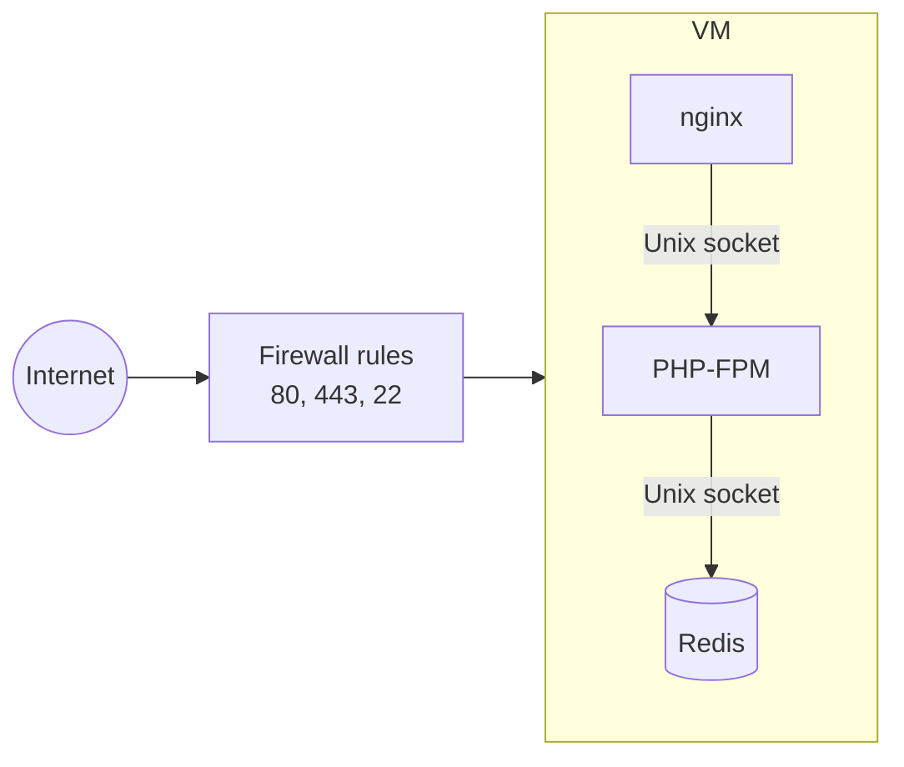

# Automated GCE Guestbook Deployment

Terraform provisions the GCP infrastructure. Ansible configures the Debian 13 host.

## Architecture



| Component       | Resource                                 | Configuration                                                      |
| --------------- | ---------------------------------------- | ------------------------------------------------------------------ |
| VPC             | `google_compute_network.vpc`             | `auto_create_subnetworks = false`, `routing_mode = "REGIONAL"`     |
| Subnet          | `google_compute_subnetwork.subnet`       | `var.region`, CIDR `10.0.1.0/24`                                   |
| Service account | `google_service_account.guestbook_vm`    | Logging and monitoring scopes, with matching IAM roles             |
| VM              | `google_compute_instance.vm`             | `debian-cloud/debian-13`, 30 GB `pd-standard`, ephemeral public IP |
| Firewall        | `allow_http`, `allow_https`, `allow_ssh` | Three rules, one per port: 80, 443, 22                             |

Each firewall rule targets one VM tag: `http-server`, `https-server`, `ssh`.

## Prerequisites

- `gcloud` CLI installed
- A GCP project with billing enabled
- Terraform >= 1.15
- Ansible >= 2.15 (ansible-core)

Authenticate and select the target project:

```bash
gcloud auth login
gcloud config set project YOUR_PROJECT_ID
```

Terraform and `gcloud` must target the same project. `terraform.tfvars` sets
the project for Terraform; `gcloud config set project` sets it for the CLI.

Enable the two required APIs:

```bash
gcloud services enable compute.googleapis.com iam.googleapis.com
```

SSH access: `make output` prints a ready-to-use `gcloud compute ssh` command.
`gcloud` generates the key pair on first use if needed.

## Quickstart

```bash
make apply
make output
make ansible-hosts
make ansible-run
```

`make output` prints the VM public IP, the SSH command, and the web URL.
The web URL uses a self-signed certificate, so browsers will show a warning.

`make ansible-hosts` generates `ansible/inventory/hosts.yaml` from the
Terraform outputs.

Use `curl -k` to skip certificate verification:

```bash
curl -k https://<vm-public-ip>/
```

## Verification

Post-deployment validation asserts three things: services active, nginx
returns HTTP 200, Redis read/write works.

```bash
make ansible-idempotency
```

The second run must report `changed=0`.

Data must survive a restart:

```bash
make ansible-persistence
```

The marker key must still be readable after Redis restarts.

Least privilege on the VM service account can be checked in two layers:

```bash
# Scopes, from inside the VM
curl -s -H "Metadata-Flavor: Google" \
  http://metadata.google.internal/computeMetadata/v1/instance/service-accounts/default/scopes

# IAM roles, from an admin machine
PROJECT_ID=$(gcloud config get-value project)
gcloud projects get-iam-policy "$PROJECT_ID" \
  --flatten="bindings[].members" \
  --filter="bindings.members:guestbook-vm@${PROJECT_ID}.iam.gserviceaccount.com" \
  --format="table(bindings.role)"
```

Both should list only logging and monitoring.

## Design decisions

- **europe-west9**: region picked for latency (~28 ms from the development
  location, measured with gcping).
- **Dedicated VPC** with per-tag firewall rules: each port opened
  independently.
- **e2-micro**: sized for a single VM running three lightweight services.
- **Service account** scoped to logging and monitoring only, with matching
  IAM roles. Stricter than GCP's `cloud-platform` default.
- **Self-signed TLS**: no domain name, so no public certificate. Generated
  at deploy time.

## Teardown

```bash
make destroy
```

Removes every resource this stack creates.

## HA roadmap

See [HA-PROPOSAL.md](HA-PROPOSAL.md) for the production migration path.

## License

The code in this repository is licensed under the Apache License 2.0. See [LICENSE](LICENSE).

The documentation (README, HA-PROPOSAL, and inline comments) is licensed under Creative Commons Attribution 4.0 International. See [LICENSE-docs](LICENSE-docs).
